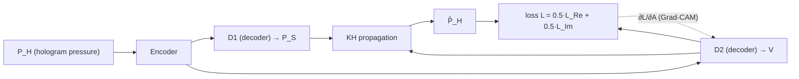

# Grad-CAM-Inspired Interpretation of Nearfield Acoustic Holography (KHCNN)

Grad-CAM-inspired explainability for **regression** networks: heatmaps for the
physics-informed **KHCNN** in Nearfield Acoustic Holography (NAH).

This repository contains the code for the explainability method presented in:

> H. Kafri, M. Olivieri, F. Antonacci, M. Moradi, A. Sarti, S. Gannot,
> **"Grad-CAM-Inspired Interpretation of Nearfield Acoustic Holography using
> Physics-Informed Explainable Neural Network"**, ICASSP 2023.
> DOI: [10.1109/ICASSP49357.2023.10097272](https://doi.org/10.1109/ICASSP49357.2023.10097272)

## Method summary

Grad-CAM was designed for classification networks, where the gradient of a
class score is backpropagated to a convolutional layer. KHCNN, however, is a
**regression** network: it estimates the surface velocity `V` of a vibrating
plate (rectangular plates or violin top plates) from the hologram pressure
`P_H`, with a Kirchhoff–Helmholtz (KH) propagation stage closing the physics
loop. This repo adapts Grad-CAM to that setting by replacing the class score
with the **KHCNN training loss** `L = 0.5·L_Re + 0.5·L_Im`, where each term
combines the velocity error `||V − V̂||²` and the pressure error
`||P_H − P̂_H||²` on the real/imaginary parts. The loss gradients are averaged
over the last convolutional activation of the velocity decoder (D2) to obtain
channel weights `α_k`, and the heatmap `H = ReLU(Σ_k α_k A^k)` is bilinearly
interpolated to the input resolution and min–max scaled to `[0, 1]`. The
heatmaps are validated by feeding the masked input `P_H ⊙ H` back to the
network (Eq. 7 of the paper) and comparing the resulting velocity estimate
`V_f` with the original estimate `V̂` (both network estimates, not the ground
truth) via NCC and NMSE.

### Reproduction notes

Several implementation details are **not specified in the paper** and are
exposed as CLI flags with assumed defaults: per-sample gradients
(`--batch-size 1`, mathematically equivalent for any batch size), min–max
scaling of the heatmap (`--scale minmax`, alternative `max` = division by the
maximum), bilinear interpolation, the sign of the backpropagated loss
(`--negate-loss` off: the paper writes `∂L/∂A`), and the noisy vs clean violin
test set (`--dataset noisy|clean`; the paper does not mention noise — the SNR
comes from the KHCNN dataset configuration and is printed at runtime).

The paper reports mean NCC = 0.98 and mean NMSE = −13.93 dB for the violin
test set. With this re-implementation (pretrained Sensors-2021 violin weights,
noisy test set, TensorFlow 2.21/Keras 3), the faithful per-spec configuration
measures **mean NCC = 0.442 and mean NMSE = −2.14 dB** (mean of per-sample dB
values; −0.98 dB when averaged in linear scale) over all 7266 test samples,
with roughly a third of the heatmaps entirely zeroed by the ReLU (the KHCNN
reconstruction itself reproduces well: NCC(V̂, V) ≈ 0.995). The per-sample
values of this run are stored in `results/gradcam_validation_metrics.csv`.

## Pipeline



## Repository structure

```
gradcam/
  run_khcnn_gradcam.py         # paper-aligned Grad-CAM (loss score, D2 target layer, Eq. 7 validation)
  run_khcnn_gradcam_center.py  # earlier variant (CENTER bottleneck layer, mean-output score)
network_module/                # KHCNN architecture (M. Olivieri, Sensors 2021)
  khcnn_network.py
  cnn_models.py
  kh_discretisation_tf.py
test_module/
  test_kh_violin.py            # KHCNN evaluation on the violin test set
  plot_results.py
utils/                         # parameters, data processing, metrics
kh_violin_model/               # pretrained violin weights (~1 MB)
test_set/                      # place the test dataset pickle here (not committed)
results/                       # output figures and metrics
```

## Installation

```bash
python -m venv venv
venv/Scripts/activate          # Windows (use source venv/bin/activate on Linux/macOS)
pip install -r requirements.txt
```

Tested with Python 3.13, TensorFlow 2.21 (Keras 3).

## Dataset

The violin test set is **not** committed (≈800 MB, over GitHub's file size
limit). Download `test_ds_violin_noisy.pickle` from the KHCNN dataset of
Olivieri et al. and place it at:

```
test_set/test_ds_violin_noisy.pickle
```

<!-- TODO: add the download link for the KHCNN violin dataset pickle -->
Dataset source: KHCNN dataset of Olivieri et al. (Sensors 2021) — *violin
pickle link TODO*. The companion rectangular-plate dataset is public on
Zenodo: [10.5281/zenodo.5702615](https://doi.org/10.5281/zenodo.5702615).

Note: the ICASSP paper does not mention noise; the noisy test set and its SNR
are taken from the KHCNN (Sensors 2021) configuration. Use `--dataset clean`
with `test_set/test_ds_violin.pickle` for the clean variant.

## Usage

Run everything from the repository root.

**Grad-CAM (paper method):**

```bash
python -m gradcam.run_khcnn_gradcam --cpu
```

Options: `--n-samples N` (validation subset, default all), `--sample-idx i j k`
(figure samples; default: the samples closest to the Fig. 3 frequencies
128.7 / 247.47 / 880.3 Hz), `--target-layer NAME` (Grad-CAM layer override),
`--out-dir DIR`, `--batch-size B`, `--scale minmax|max`, `--negate-loss`,
`--dataset noisy|clean`.

Expected outputs in `results/`:

- `gradcam_violin_summary.png` — figure in the style of Fig. 3 of the paper:
  rows `|P_H|`, `|V̂|`, `|V|` ground truth and heatmap `H` for 3 samples at
  different frequencies;
- `gradcam_validation_metrics.csv` — per-sample NCC/NMSE of the Eq. 7
  validation, with the means (NMSE averaged both over dB values and in linear
  scale) printed to stdout.

**Earlier Grad-CAM variant** (bottleneck `CENTER_*` layer, mean-output score,
kept for reference):

```bash
python -m gradcam.run_khcnn_gradcam_center
```

**KHCNN test script** (reconstruction metrics and plots on the violin set):

```bash
python -m test_module.test_kh_violin
```

## NOTICE / credits

- The KHCNN network code (`network_module/`, parts of `utils/` and
  `test_module/`) comes from the **KHCNN** implementation by **Marco
  Olivieri**:
  M. Olivieri, M. Pezzoli, F. Antonacci, A. Sarti, *"A Physics-Informed Neural
  Network Approach for Nearfield Acoustic Holography"*, Sensors 2021, 21(23),
  7834. DOI: [10.3390/s21237834](https://doi.org/10.3390/s21237834).
  The upstream code is licensed under GPL-3.0; this repository is therefore
  distributed under **GPL-3.0** as well (see [LICENSE](LICENSE)).

## Related work

- R. R. Selvaraju, M. Cogswell, A. Das, R. Vedantam, D. Parikh, D. Batra,
  *"Grad-CAM: Visual Explanations from Deep Networks via Gradient-based
  Localization"*, ICCV 2017.
- [Grad-CAM-for-video-and-regression-task](https://github.com/vijayredkar/Grad-CAM-for-video-and-regression-task) —
  a reference project on applying Grad-CAM to regression tasks (not included
  in this repository).
- Follow-up repository: [hkafri/septfanet-gradcam](https://github.com/hkafri/septfanet-gradcam).

## Citation

```bibtex
@inproceedings{kafri2023gradcam,
  author    = {Kafri, Hagar and Olivieri, Marco and Antonacci, Fabio and
               Moradi, Mordehay and Sarti, Augusto and Gannot, Sharon},
  title     = {Grad-CAM-Inspired Interpretation of Nearfield Acoustic
               Holography using Physics-Informed Explainable Neural Network},
  booktitle = {ICASSP 2023 - 2023 IEEE International Conference on Acoustics,
               Speech and Signal Processing (ICASSP)},
  year      = {2023},
  doi       = {10.1109/ICASSP49357.2023.10097272}
}
```

See also [CITATION.cff](CITATION.cff).
